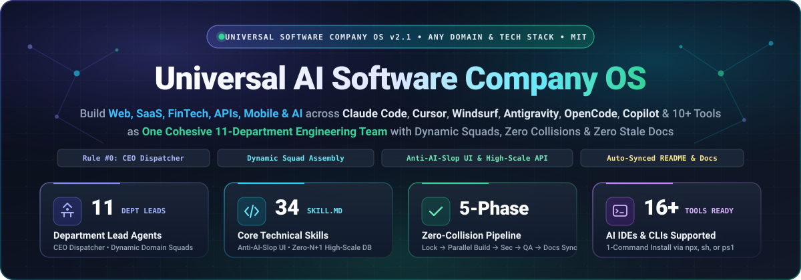
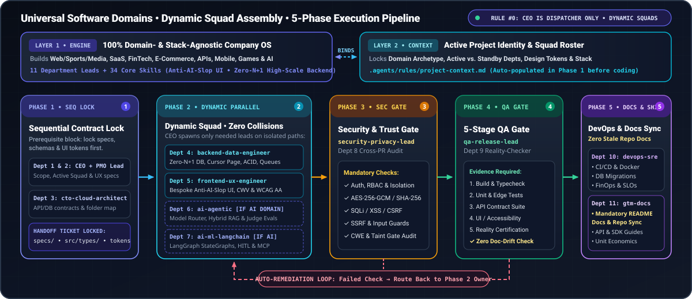

<div align="center">



# 🏢 Universal AI Software Company OS

**Turn Claude Code, Cursor, Windsurf, Google Antigravity, OpenCode, GitHub Copilot, and 10+ other AI coding tools into One Cohesive Enterprise Software Company — engineered to build ANY software product.**

[](LICENSE)
[](#-the-11-department-lead-subagents--34-core-technical-skills)
[](#-the-11-department-lead-subagents--34-core-technical-skills)
[](#️-supported-ai-coding-tools-ides--clis-16-platforms-out-of-the-box)
[](#-30-second-quickstart-3-ways-to-install)
[](CONTRIBUTING.md)

[**⚡ 30-Second Quickstart**](#-30-second-quickstart-3-ways-to-install) • [**🎯 Dynamic Squad Assembly**](#-dynamic-squad-assembly-how-the-ceo-adapts-to-any-project-domain) • [**🏛️ Engineering Standards**](#️-real-company-engineering-standards) • [**🚀 3-Step Usage Guide**](#-how-to-use-it-in-3-simple-steps-for-new-users) • [**🛠️ 16+ Supported IDEs**](#️-supported-ai-coding-tools-ides--clis-16-platforms-out-of-the-box) • [**🔄 5-Phase Pipeline**](#-visual-5-phase-execution-pipeline) • [**📖 IDE Setup Guide**](docs/IDE_SETUP_GUIDE.md)

</div>

---

## 🌐 Built for Every Software Domain — Not Just AI Products

Whether you are shipping a **Broadcast Sports & Media Portal**, a **High-Concurrency FinTech or E-Commerce Platform**, a **Full-Stack SaaS Application**, a **Scalable Backend Microservice**, a **Mobile/Desktop App**, an **Interactive Game**, or an **AI/Agentic System**, this operating system runs your AI coding assistant like a real, high-output engineering organization:

- **⚽ Interactive Web, Sports, Media & Creative Portals** — Bespoke domain aesthetics, kinetic typography, custom SVG visuals, and Core Web Vitals optimization.
- **💳 Full-Stack SaaS, E-Commerce, Booking & FinTech Platforms** — Clean/Hexagonal architectures, ACID-compliant payment ledgers, cursor pagination, and zero `N+1` database queries.
- **⚡ High-Concurrency APIs, Microservices & Data Pipelines** — Horizontally scalable backend services, Redis caching, idempotent webhooks, and resilient background queues.
- **🤖 AI-Native SaaS, Hybrid RAG, Autonomous Agents & MCP Servers** — Multi-provider model routers, stateful LangGraph workflows, human-in-the-loop interrupts, and LLM-as-a-Judge evaluations.

---

## 💡 Why This Exists (The Problem With Multi-Agent Prompt Dumps)

Most AI agent repositories dump **150+ uncoordinated markdown prompts** into your workspace. When you try to build real software with them, five things break immediately:

1. **Cowboy Coding by the Main Agent**: Even when subagents exist, the main AI assistant panics on urgent requests (`"build this fast"`), ignores the team, and writes sloppy monolithic code by itself.
2. **Context Window Bloat & Persona Confusion**: Your AI reads 150 overlapping prompts on every turn, activates AI/LLM agents on non-AI web projects, and mixes conflicting coding styles.
3. **Parallel File Collisions**: Subagents overwrite each other's files because no architect locked the shared TypeScript/Python interfaces, database schemas, design tokens, or folder boundaries before Phase 2 coding started.
4. **Generic "AI-Slop" UI & Fantasy QA Approvals**: Frontends default to generic purple-gradient templates with 3-emoji cards, and tasks are declared "complete" without running a real security audit or executing tests.
5. **Stale `README.md` & Documentation Drift**: Engineers ship new features, CLI flags, or folder changes while leaving `README.md` and `docs/` months out of date.

### ✅ How Universal AI Software Company OS Solves It

We separated the **Universal Company Operating System** from your **Project Context**:

- **Layer 1 — Universal Company Engine (`100% Domain- & Stack-Agnostic`)**: **11 Department Lead Subagents** + **34 Core Technical Skills** + **Dynamic Squad Assembly** + a strict **5-Phase Execution Pipeline**.
- **Layer 2 — Single Project Identity Card ([`.agents/rules/project-context.md`](.agents/rules/project-context.md))**: The **ONLY** file in your workspace that stores your project's domain archetype, active department squad, aesthetic direction, tech stack, scalability guardrails, and directory map — **automatically generated** by your CEO, PMO, and CTO agents on your first prompt.

| Capability | Typical 150-Prompt Agent Dumps | Single `.cursorrules` / `CLAUDE.md` File | **Universal AI Software Company OS** |
| :--- | :--- | :--- | :--- |
| **Executive Governance** | ❌ Main agent codes randomly | ❌ Single-threaded cowboy coding | ✅ **Strict Rule #0: CEO Orchestrates; Never Codes Alone** |
| **Domain Adaptability** | ❌ Forces AI/LLM prompts onto non-AI apps | ⚠️ Static one-size-fits-all rules | ✅ **Dynamic Squad Assembly (Standby Depts Stay Quiet)** |
| **Frontend Craft** | ❌ Generic purple/neon AI-slop templates | ⚠️ Generic component output | ✅ **Anti-AI-Slop Bespoke Domain UI (`frontend-ux-engineer`)** |
| **Backend & DB Scale** | ❌ Naive queries & race conditions | ⚠️ Unstructured endpoints | ✅ **Clean Architecture, Zero `N+1`, ACID Locks & Queues** |
| **Parallel Subagent Safety** | ❌ Agents overwrite the same files | ❌ Single-threaded execution | ✅ **Phase 1 Contract Lock + 4-Field Hand-off Tickets** |
| **Security & Release Gate** | ❌ "Looks good to me" fantasy approvals | ❌ Unenforced | ✅ **Mandatory Phase 3 CISO Audit + Phase 4 5-Stage QA Gate** |
| **README & Docs Freshness** | ❌ `README.md` becomes stale immediately | ❌ Docs forgotten after code edits | ✅ **Rule #0.4: Mandatory Phase 5 README & Docs Sync Gate** |
| **Cross-Tool Portability** | ⚠️ Usually locked to 1 tool | ⚠️ Locked to 1 editor | ✅ **16+ AI IDEs & CLIs Out-of-the-Box** |

---

## 🎯 Dynamic Squad Assembly (How the CEO Adapts to Any Project Domain)

Not every software project uses AI, and not every feature requires all 11 departments. Under **`AGENTS.md`**, the CEO (`ceo-executive-orchestrator`) classifies your project domain and dynamically activates **only the exact Department Squad required** — keeping unneeded departments (like AI Depts 6 & 7 on a traditional web or SaaS build) cleanly on **`STANDBY`**, while always syncing `README.md` and `docs/` in Phase 5 whenever repository features or structure change:

| Project / Task Archetype | Dynamically Activated Department Squad (In Execution Order) | Standby Departments (Never Invoked Unless Needed) |
| :--- | :--- | :--- |
| **⚽ Interactive Web, Media, Sports, Creative or Landing Portal** | `ceo` ➔ (`product-pmo` + `cto-architect`) ➔ `frontend-ux-engineer` ➔ `qa-release-lead` ➔ `gtm-business-ops-lead` *(README/Docs sync)* | `backend-data`, `ai-agentic`, `ai-ml-langchain`, `security`, `devops` |
| **💳 Full-Stack SaaS, E-Commerce, FinTech, Booking, or Enterprise App (Non-AI)** | `ceo` ➔ (`product-pmo` + `cto-architect`) ➔ **Parallel:** [`backend-data-engineer` ∥ `frontend-ux-engineer`] ➔ `security-privacy-lead` ➔ `qa-release-lead` ➔ `devops-sre-lead` + `gtm-business-ops-lead` | `ai-agentic-engineer`, `ai-ml-langchain-automation-lead` |
| **⚡ High-Scale Backend API, Microservice, Payment Gateway, or Data Pipeline** | `ceo` ➔ (`product-pmo` + `cto-architect`) ➔ `backend-data-engineer` ➔ `security-privacy-lead` ➔ `qa-release-lead` ➔ `devops-sre-lead` + `gtm-business-ops-lead` | `frontend-ux-engineer`, `ai-agentic`, `ai-ml-langchain` |
| **🤖 AI-Native SaaS, RAG Platform, Autonomous Agents, or MCP Server** | `ceo` ➔ (`product-pmo` + `cto-architect`) ➔ **Parallel:** [`backend-data` ∥ `frontend-ux` ∥ `ai-agentic` ∥ `ai-ml-langchain`] ➔ `security-privacy` ➔ `qa-release` ➔ `devops` + `gtm` | *All 11 Departments Active* |
| **🔧 Targeted UI Redesign, Bug Fix, or Performance Optimization** | `ceo` ➔ (`cto-architect` if contract changes) ➔ Owning Lead (`frontend-ux` or `backend-data`) ➔ `qa-release-lead` ➔ (`gtm` if CLI/API/repo structure changed) | All unrelated departments |

---

## 🏛️ Real-Company Engineering Standards

### 1. The Executive Orchestrator Mandate (Strict Rule #0 & Urgency Protocol)
- **The Main Agent Is Your CEO & Chief of Staff (`ceo-executive-orchestrator`)**: It serves as your Single Point of Contact and **never** bypasses the company pipeline to write application, UI, backend, or database code directly by itself.
- **Built for Speed Without Chaos (Rule #0.3)**: When you ask for something *"fast"*, *"quickly"*, or *"ASAP"*, the CEO never abandons the company structure to cowboy-code alone. Instead, urgency triggers **Zero Bureaucracy + Immediate Parallel Dispatch**: locking the Phase 1 contract in seconds, presenting a **3-Line Executive Dispatch Briefing**, spawning the required Department Leads in parallel, and running a fast-track QA verification gate.
- **Mandatory GitHub Repo & Documentation Sync (Rule #0.4 — Zero Stale README/Docs)**: No feature, architectural update, CLI flag, or folder restructuring is ever allowed to leave `README.md` or `docs/` outdated. Whenever a task changes user-facing functionality, setup commands, or repository structure, the CEO dispatches **`gtm-business-ops-lead` (Dept 11)** in Phase 5 to synchronize `README.md` and `docs/`, and **`qa-release-lead` (Dept 9)** verifies zero documentation drift in Stage 5 before final sign-off.

### 2. Anti-AI-Slop Creative Frontend (`frontend-ux-engineer` — Dept 5)
- **Bans Generic AI Templates**: Strictly prohibits generic purple/indigo neon gradients, glowing orbs, unrequested dark-mode SaaS clichés, and 3-column emoji feature boxes.
- **Bespoke Domain-Authentic UI**: Crafts intentional typography pairings, custom SVG visuals, asymmetric Bento grids, tactile micro-interactions, and strict Core Web Vitals (`LCP < 2.0s`, `CLS < 0.05`, WCAG 2.1 AA) calibrated to your domain persona (*Broadcast Sports Energy*, *High-Trust Precision FinTech*, *Editorial Luxury*, *Tactile E-Commerce*, or *Industrial Developer Console*).

### 3. Enterprise-Grade Scalable Architecture & Backend (`cto-cloud-architect` & `backend-data-engineer` — Depts 3 & 4)
- **Contract-First Engineering**: Phase 1 locks Clean/Hexagonal boundaries, shared data models (`src/types/`), OpenAPI/RPC schemas, and non-overlapping folder ownership before Phase 2 begins.
- **High-Concurrency & Data Integrity**: Enforces zero `N+1` queries, composite database indexing, cursor-based pagination, ACID row-level locking for financial/inventory state, idempotent payment ledgers, Redis caching with stampede protection, and exponential-backoff job queues with Dead-Letter Queues (DLQ).

### 4. Structured 4-Field Inter-Department Hand-off Tickets
Every subagent dispatch follows a strict 4-field contract so parallel agents never collide:
1. **`[CONTEXT & INPUT CONTRACTS]`** — References `.agents/rules/project-context.md` and the exact schemas/tokens locked in Phase 1.
2. **`[OWNED FILE BOUNDARY]`** — Exact directories and files the department is permitted to create or modify.
3. **`[EXCELLENCE & ACCEPTANCE CRITERIA]`** — Domain quality bar (e.g., *Zero AI-Slop bespoke UI*, *Zero N+1 queries*, *Strict type safety*).
4. **`[DOWNSTREAM HANDOFF]`** — Next verification gate (`security-privacy-lead` / `qa-release-lead` / `gtm-business-ops-lead`) and required test commands.

---

## ⚡ 30-Second Quickstart (3 Ways to Install)

### Method 1: Instant `npx` CLI (Any OS, Zero Clone Required)

Run directly inside any new or existing project directory (requires Node.js 18+):

```bash
# Install all 11 departments, 34 skills, and configs for all supported AI tools
npx github:abdelrahman-elkot/universal-ai-software-company . --agent all

# Or install only for your specific AI coding tool (or comma-separated list):
npx github:abdelrahman-elkot/universal-ai-software-company . --agent claude
npx github:abdelrahman-elkot/universal-ai-software-company . --agent cursor,claude
npx github:abdelrahman-elkot/universal-ai-software-company . --agent windsurf
npx github:abdelrahman-elkot/universal-ai-software-company . --agent antigravity
npx github:abdelrahman-elkot/universal-ai-software-company . --agent opencode
npx github:abdelrahman-elkot/universal-ai-software-company . --agent copilot

# List all 11 departments, 34 skills, and 16 supported agent targets
npx github:abdelrahman-elkot/universal-ai-software-company --list

# Run the built-in health check & project-context verifier
npx github:abdelrahman-elkot/universal-ai-software-company . --doctor
```

### Method 2: macOS / Linux / Git Bash (`install.sh`)

```bash
git clone https://github.com/abdelrahman-elkot/universal-ai-software-company.git && ./universal-ai-software-company/install.sh /path/to/your-project all
```

### Method 3: Windows PowerShell (`install.ps1`)

```powershell
git clone https://github.com/abdelrahman-elkot/universal-ai-software-company.git; .\universal-ai-software-company\install.ps1 -TargetDir "C:\path\to\your-project" -Agent all
```

> 💡 **Safe for Existing Projects**: The installer **never overwrites** an already-initialized `.agents/rules/project-context.md` unless you explicitly pass `--force-context` (or `-ForceOverwriteContext` in PowerShell). See the full **[Quickstart Guide (`docs/QUICKSTART.md`)](docs/QUICKSTART.md)** for details.

---

## 🚀 How to Use It in 3 Simple Steps (For New Users)

### Step 1: Install Into Your Project
Run any of the 3 installation commands above inside your new or existing repository.

### Step 2: Auto-Onboard Your Repository (`"Initialize project context"`)
Open your project in your AI coding tool (Claude Code, Cursor, Windsurf, Antigravity, OpenCode, Copilot, etc.) and send this single prompt:

```text
Initialize project context
```

**What happens automatically:**
1. **Dept 1 (`ceo-executive-orchestrator`)**, **Dept 2 (`product-pmo-lead`)**, and **Dept 3 (`cto-cloud-architect`)** scan your repository (`README.md`, `package.json`, `pyproject.toml`, `go.mod`, `Cargo.toml`, database schemas, and `src/` folder layout).
2. They populate **[`.agents/rules/project-context.md`](.agents/rules/project-context.md)** with:
   - Your **Project Domain & Archetype** and **Active Department Squad** (placing unneeded departments on `STANDBY`).
   - Your **Creative Direction & UI/UX Aesthetic System** (if your project has a frontend).
   - Your **Approved Tech Stack, Scalability Guardrails & Non-Overlapping Directory Map**.

### Step 3: Build Any Software Product, Fix Bugs, or Run Audits (Copy-Paste Starter Prompts)

Talk to your AI naturally—the CEO automatically dispatches the right squad. Or copy-paste any of these **Ready-to-Use Starter Prompts**:

| Project / Workflow Goal | Copy-Paste Starter Prompt | Active Squad Dispatched by CEO |
| :--- | :--- | :--- |
| **⚽ High-Energy Sports / Media Web Portal (Non-AI)** | `"Build an interactive football match center and live standings portal with a Broadcast Sports aesthetic, kinetic typography, custom pitch SVGs, and instant tab filtering."` | `ceo` ➔ `product-pmo` + `cto-architect` ➔ `frontend-ux-engineer` ➔ `qa-release-lead` ➔ `gtm` *(AI Depts on Standby)* |
| **💳 Scalable E-Commerce / FinTech Checkout Backend** | `"Design and build an idempotent checkout and payment webhook microservice with ACID inventory locking, cursor-paginated order history, Redis caching, and dead-letter queues."` | `ceo` ➔ `product-pmo` + `cto-architect` ➔ `backend-data-engineer` ➔ `security-privacy` ➔ `qa-release` ➔ `devops` + `gtm` |
| **📊 Full-Stack SaaS Application (Parallel Build)** | `"Run the 5-Phase Company Pipeline to build a multi-tenant analytics dashboard and REST API: lock contracts in Phase 1, run backend-data-engineer and frontend-ux-engineer in parallel in Phase 2, audit RBAC security in Phase 3, run the 5-Stage QA gate in Phase 4, and sync README/docs in Phase 5."` | Depts `1` ➔ `2, 3` ➔ **Parallel:** [`4` ∥ `5`] ➔ `8` ➔ `9` ➔ `10, 11` |
| **📐 Phase 1 Architecture, Design Tokens & DB Lock** | `"Use product-pmo-lead and cto-cloud-architect to decompose [FEATURE/SPEC] into engineering tickets and lock the shared TypeScript/API contracts, DB schema, and design tokens before coding."` | Dept `2` (`product-pmo-lead`) + Dept `3` (`cto-cloud-architect`) |
| **🤖 Stateful LangGraph / AI Agent Workflow** | `"Use ai-ml-langchain-automation-lead and ai-agentic-engineer to build a stateful LangGraph workflow with human-in-the-loop interrupt(), multi-provider model routing, hybrid RAG, and evaluation tests."` | Dept `6` (`ai-agentic-engineer`) + Dept `7` (`ai-ml-langchain-automation-lead`) |
| **🔐 AppSec, Cryptography & CWE Audit (Phase 3)** | `"Use security-privacy-lead to perform a Phase 3 security and CWE audit across our authentication, RBAC, secret encryption, SQL parameterization, SSRF shields, and untrusted-content taint gates."` | Dept `8` (`security-privacy-lead`) |
| **🧪 5-Stage QA & Reality-Checker Gate (Phase 4)** | `"Use qa-release-lead to execute the 5-Stage Release Gate: run build/typecheck, unit tests, API contract tests, UI/accessibility checks, and verify zero README/documentation drift."` | Dept `9` (`qa-release-lead`) |

---

## 🛠️ Supported AI Coding Tools, IDEs & CLIs (16 Platforms Out-of-the-Box)

Universal AI Software Company OS ships with native configuration files and adapters for **16 AI coding platforms**. See **[`docs/IDE_SETUP_GUIDE.md`](docs/IDE_SETUP_GUIDE.md)** for exact slash commands and `@agent` syntax for each tool.

| # | AI Coding Tool / IDE / CLI (`--agent`) | Native Configuration Files Installed | How Subagents & Skills Are Invoked |
| :---: | :--- | :--- | :--- |
| **1** | **Claude Code (`claude`)** | `CLAUDE.md`, `.claude/agents/*.md`, `.claude/skills/*/SKILL.md` | Automatic CEO delegation + `/agents` command & `@agent-name` mentions |
| **2** | **Cursor (`cursor`)** | `.cursor/rules/software-company.mdc`, `.cursorrules`, `AGENTS.md`, `.agents/skills/` | Always-on `.mdc` & `.cursorrules` routing + `@software-company.mdc` mentions |
| **3** | **Windsurf (`windsurf`)** | `.windsurf/rules/software-company.md`, `.windsurfrules`, `AGENTS.md` | Cascade auto-loads workspace rules + `@AGENTS.md` & `.agents/skills/` |
| **4** | **Google Antigravity (`antigravity`)** | `AGENTS.md`, `.agents/agents/*.md`, `.agents/skills/`, `.agents/plugins/software-company-team/` | Native `invoke_subagent` tool + Workspace Priority #1 skill & rule loader |
| **5** | **OpenCode (`opencode`)** | `AGENTS.md`, `.opencode/agent/*.md`, `.agents/skills/*/SKILL.md` | Native `@agent-id` subagent invocation (`mode: subagent`) + `AGENTS.md` |
| **6** | **GitHub Copilot (`copilot`)** | `.github/copilot-instructions.md`, `.github/agents/*.agent.md` | Repo-wide instructions + 11 custom Copilot agents (`@ceo-executive-orchestrator`, etc.) |
| **7** | **Cline (`cline`)** | `.clinerules/software-company.md`, `AGENTS.md`, `.agents/skills/` | Automatic `.clinerules/` ingestion + on-demand `SKILL.md` reading |
| **8** | **Roo Code (`roo`)** | `.roo/rules/software-company.md`, `.roorules`, `AGENTS.md` | Automatic `.roo/rules/` & `.roorules` workspace governance + Boomerang orchestration |
| **9** | **OpenAI Codex CLI (`codex`)** | `.codex/instructions.md`, `AGENTS.md`, `.agents/skills/*/SKILL.md` | Native `.codex/instructions.md` & `AGENTS.md` discovery + `.agents/skills/` |
| **10** | **Google Gemini CLI (`gemini`)** | `GEMINI.md`, `.gemini/settings.json`, `AGENTS.md`, `.agents/skills/*/SKILL.md` | Automatic `GEMINI.md` & `.gemini/settings.json` context loader |
| **11** | **Aider (`aider`)** | `.aider.conf.yml`, `AGENTS.md`, `.agents/rules/project-context.md` | Auto-loaded `read: [AGENTS.md, .agents/rules/project-context.md]` |
| **12** | **Continue.dev (`continue`)** | `.continue/rules/software-company.md`, `AGENTS.md` | Workspace `.continue/rules/` system prompt injection |
| **13** | **Zed AI (`zed`)** | `.rules`, `AGENTS.md`, `.agents/skills/` | Native root `.rules` & `AGENTS.md` context loading |
| **14** | **Trae IDE (`trae`)** | `.trae/rules/project_rules.md`, `AGENTS.md` | Builder mode automatic `.trae/rules/project_rules.md` governance |
| **15** | **Kilo Code (`kilo` / `kilocode`)** | `.kilocode/rules/software-company.md`, `AGENTS.md` | Workspace `.kilocode/rules/software-company.md` governance + Orchestrator mode |
| **16** | **Block Goose (`goose`)** | `.goosehints`, `AGENTS.md`, `.agents/skills/` | Automatic `.goosehints` & `.agents/skills/` discovery |

---

## 🔄 Visual 5-Phase Execution Pipeline

<div align="center">

</div>

A real software company never runs blind parallelism where Frontend guesses what Backend will build. Every feature, milestone, or bug fix follows strict **Sequential Dependency Locks** followed by **Isolated Parallel Execution**:

1. **Phase 1 — Product, Aesthetic & Architecture Lock (`product-pmo-lead` + `cto-cloud-architect`)**
   - Reads **[`.agents/rules/project-context.md`](.agents/rules/project-context.md)**, defines scope, domain aesthetic, and acceptance criteria, and locks shared data models, API contracts (`src/types/`), design tokens, and non-overlapping folder boundaries before any implementation begins.
2. **Phase 2 — Safe Parallel Engineering Build (`Dynamic Squad — Zero File Collisions`)**
   - Only the departments required for your project archetype execute in parallel, each strictly confined to its `[OWNED FILE BOUNDARY]`:
     - **Dept 4 (`backend-data-engineer`)**: Horizontally scalable APIs, zero-`N+1` indexed SQL/NoSQL queries, cursor pagination, ACID locks, idempotent payment ledgers, Redis caching, and queues.
     - **Dept 5 (`frontend-ux-engineer`)**: Bespoke, anti-AI-slop domain UI, intentional typography & color tokens, custom SVGs, client state, and responsive layouts.
     - **Dept 6 (`ai-agentic-engineer`)** *(Activated for AI features)*: Multi-provider LLM routers, hybrid RAG/search grounding, re-ranking, and LLM-as-a-Judge evaluations.
     - **Dept 7 (`ai-ml-langchain-automation-lead`)** *(Activated for AI/Automation features)*: Stateful LangGraph (`StateGraph`, `Send`, checkpointers, `interrupt()` HITL), LangChain, CrewAI/AutoGen/DSPy, and MCP servers.
3. **Phase 3 — Mandatory Security & Trust-Boundary Audit (`security-privacy-lead`)**
   - Audits authentication/RBAC, `AES-256-GCM` / `SHA-256` cryptography, SQLi/XSS/CSRF/SSRF prevention, rate limiting, untrusted-content taint gates, and CWE compliance.
4. **Phase 4 — Mandatory 5-Stage QA, Reality-Checker & Docs-Drift Gate (`qa-release-lead`)**
   - Runs real verification commands across 5 stages: **(1) Build, Typecheck & Lint**, **(2) Unit & Edge-Case Tests**, **(3) API Contract Tests**, **(4) UI/E2E & Accessibility Validation**, and **(5) Reality-Checker & Documentation Drift Certification** (verifying that `README.md`, `docs/`, and directory trees match the actual codebase). Any failure routes directly back to the owning engineer.
5. **Phase 5 — DevOps Sync, Mandatory README/Docs Update & Executive Delivery (`devops-sre-lead` + `gtm-business-ops-lead`)**
   - Verifies Docker/Cloud/Edge deployment configs, zero-downtime migrations, CI/CD pipelines, and SLO/FinOps guardrails, while **`gtm-business-ops-lead` enforces Rule #0.4** by updating `README.md`, `docs/`, and API references in the same turn before final CEO sign-off.

---

## 🏛️ The 11 Department Lead Subagents & 34 Core Technical Skills

Each Department Lead owns a dedicated engineering discipline and loads **2 to 4 specialized technical skills** with zero overlap:

| Dept # | Subagent ID | Core Responsibility & Excellence Mandate | Default Owned Paths | Assigned Core Skills (`.agents/skills/`) |
| :---: | :--- | :--- | :--- | :--- |
| **1** | [`ceo-executive-orchestrator`](.agents/agents/ceo-executive-orchestrator.md) | **Single Point of Contact & Pipeline Dispatcher** — Classifies user intent, locks `project-context.md`, assembles the Active Squad, enforces handoffs & signs off delivery | Workspace-wide coordination (`.agents/rules/project-context.md`) | • [`executive-ceo-founder`](.agents/skills/executive-ceo-founder/SKILL.md)<br>• [`agents-orchestrator`](.agents/skills/agents-orchestrator/SKILL.md)<br>• [`specialized-master-plan-architect`](.agents/skills/specialized-master-plan-architect/SKILL.md) |
| **2** | [`product-pmo-lead`](.agents/agents/product-pmo-lead.md) | **Product Strategy, Specs & UX Flows** — Decomposes user goals into structured engineering tickets with explicit inputs, acceptance criteria & frictionless user journeys | `specs/`, `docs/prd/`, task plans | • [`product-manager`](.agents/skills/product-manager/SKILL.md)<br>• [`project-manager-senior`](.agents/skills/project-manager-senior/SKILL.md)<br>• [`product-dx-engineer`](.agents/skills/product-dx-engineer/SKILL.md) |
| **3** | [`cto-cloud-architect`](.agents/agents/cto-cloud-architect.md) | **Enterprise System Architecture & Contract Lock** — Designs Clean/Hexagonal architectures, strict API/schema contracts, caching/queue topologies & FinOps guardrails | `src/types/`, `src/contracts/`, `src/interfaces/` | • [`engineering-cto-vp`](.agents/skills/engineering-cto-vp/SKILL.md)<br>• [`engineering-software-architect`](.agents/skills/engineering-software-architect/SKILL.md)<br>• [`engineering-cloudflare-edge-architect`](.agents/skills/engineering-cloudflare-edge-architect/SKILL.md) |
| **4** | [`backend-data-engineer`](.agents/agents/backend-data-engineer.md) | **High-Scale Backend, APIs, Databases & Billing** — Horizontally scalable servers, zero-`N+1` indexed queries, cursor pagination, ACID locks, idempotent billing, Redis & queues | `src/backend/`, `src/api/`, `src/server/`, `src/worker/`, `src/db/`, `src/queues/`, `migrations/` | • [`engineering-backend-architect`](.agents/skills/engineering-backend-architect/SKILL.md)<br>• [`engineering-database-optimizer`](.agents/skills/engineering-database-optimizer/SKILL.md)<br>• [`engineering-data-engineer`](.agents/skills/engineering-data-engineer/SKILL.md)<br>• [`engineering-payments-billing-engineer`](.agents/skills/engineering-payments-billing-engineer/SKILL.md) |
| **5** | [`frontend-ux-engineer`](.agents/agents/frontend-ux-engineer.md) | **Bespoke Creative UI/UX & Anti-AI-Slop Frontend** — Domain-authentic interfaces (Broadcast Sports, Precision FinTech, Editorial Luxury, Tactile E-Commerce); bans generic AI templates | `src/ui/`, `src/client/`, `src/components/`, `src/styles/`, `src/media/`, `public/`, `index.html` | • [`engineering-frontend-developer`](.agents/skills/engineering-frontend-developer/SKILL.md)<br>• [`design-ux-architect`](.agents/skills/design-ux-architect/SKILL.md)<br>• [`design-ui-designer`](.agents/skills/design-ui-designer/SKILL.md) |
| **6** | [`ai-agentic-engineer`](.agents/agents/ai-agentic-engineer.md) | *(Activated for AI features)* **LLM Routers, RAG & Evals** — Multi-provider model routing, hybrid vector/BM25 retrieval, re-ranking, search grounding & LLM-as-a-Judge evals | `src/router/`, `src/modes/`, `src/search/`, `src/eval/` | • [`engineering-multi-agent-systems-architect`](.agents/skills/engineering-multi-agent-systems-architect/SKILL.md)<br>• [`engineering-rag-pipeline-engineer`](.agents/skills/engineering-rag-pipeline-engineer/SKILL.md)<br>• [`engineering-prompt-engineer`](.agents/skills/engineering-prompt-engineer/SKILL.md) |
| **7** | [`ai-ml-langchain-automation-lead`](.agents/agents/ai-ml-langchain-automation-lead.md) | *(Activated for AI/Automation features)* **LangGraph, Workflows & MCP** — Stateful cyclic/DAG agent graphs, `Send` map-reduce, HITL `interrupt()`, LangChain, MCP servers & MLOps | `src/agents/`, `src/graphs/`, `src/workflows/`, `src/mcp/`, `sdk/` | • [`engineering-langchain-langgraph-automation`](.agents/skills/engineering-langchain-langgraph-automation/SKILL.md)<br>• [`engineering-ai-engineer`](.agents/skills/engineering-ai-engineer/SKILL.md)<br>• [`specialized-mcp-builder`](.agents/skills/specialized-mcp-builder/SKILL.md) |
| **8** | [`security-privacy-lead`](.agents/agents/security-privacy-lead.md) | **AppSec, Cryptography & Trust Boundaries** — Audits auth/RBAC, `AES-256-GCM` / `SHA-256` crypto, SQLi/XSS/CSRF/SSRF prevention, rate limiting, untrusted-content taint gates & CWE compliance | `src/security/`, `src/crypto/`, `src/auth/` | • [`security-architect`](.agents/skills/security-architect/SKILL.md)<br>• [`security-appsec-engineer`](.agents/skills/security-appsec-engineer/SKILL.md)<br>• [`security-ai-generated-code-auditor`](.agents/skills/security-ai-generated-code-auditor/SKILL.md) |
| **9** | [`qa-release-lead`](.agents/agents/qa-release-lead.md) | **5-Stage Release Gate & Reality-Checker Certification** — Runs real build/typecheck, unit/integration/API contract tests, UI/accessibility validation, and README/docs drift checks | `tests/`, `e2e/`, `vitest.config.ts`, `playwright.config.ts` | • [`testing-release-gate-manager`](.agents/skills/testing-release-gate-manager/SKILL.md)<br>• [`testing-api-tester`](.agents/skills/testing-api-tester/SKILL.md)<br>• [`testing-test-automation-engineer`](.agents/skills/testing-test-automation-engineer/SKILL.md)<br>• [`testing-reality-checker`](.agents/skills/testing-reality-checker/SKILL.md) |
| **10** | [`devops-sre-lead`](.agents/agents/devops-sre-lead.md) | **Cloud/Containers, CI/CD, Observability & FinOps** — Docker/K8s/Serverless configs, zero-downtime DB migrations, CI/CD pipelines, health probes, SLOs & cloud cost guardrails | `Dockerfile`, `docker-compose.yml`, `wrangler.toml`, `.github/workflows/`, `scripts/`, `package.json`, `tsconfig.json` | • [`engineering-devops-automator`](.agents/skills/engineering-devops-automator/SKILL.md)<br>• [`engineering-sre`](.agents/skills/engineering-sre/SKILL.md)<br>• [`engineering-finops-engineer`](.agents/skills/engineering-finops-engineer/SKILL.md) |
| **11** | [`gtm-business-ops-lead`](.agents/agents/gtm-business-ops-lead.md) | **DevRel, Live Documentation Sync & Unit Economics** — Enforces Rule #0.4 (zero stale `README.md`/`docs/`), authors API references, onboarding guides & SaaS pricing/margin models | `docs/`, `README.md`, `CONTRIBUTING.md`, `examples/` | • [`engineering-technical-writer`](.agents/skills/engineering-technical-writer/SKILL.md)<br>• [`specialized-pricing-analyst`](.agents/skills/specialized-pricing-analyst/SKILL.md) |

---

## 🖥️ Interactive Web Showcase & Command Builder

Explore the entire architecture visually by opening **[`docs/index.html`](docs/index.html)** in any browser (or via GitHub Pages):

- **Interactive CLI Command Builder**: Pick your OS (`npx`, `macOS/Linux`, `Windows PowerShell`) and target AI coding tool (`all`, `claude`, `cursor`, `windsurf`, `antigravity`, `opencode`, `copilot`, etc.) to generate a one-click copyable install command.
- **11-Department Interactive Explorer**: Filter departments by pipeline phase, inspect owned paths, and copy department-specific starter prompts.
- **Live 34-Skill Search**: Search across all 34 engineering, architecture, frontend, backend, database, payments, AI, security, QA, DevOps, product, and executive skills.

---

## 📁 Repository Structure

```text
universal-ai-software-company/
├── AGENTS.md                              # Universal Company Operating System, Rule #0 & Dynamic Squad Matrix
├── CLAUDE.md                              # Claude Code root entry point (@AGENTS.md + @project-context.md)
├── GEMINI.md                              # Gemini CLI root entry point
├── CONTRIBUTING.md                        # Contributor guidelines & Rule #0.4 Documentation Sync Checklist
├── LICENSE                                # MIT License
├── package.json                           # Zero-dependency npx CLI package manifest
├── bin/
│   └── cli.mjs                            # Cross-platform npx installer, --list & --doctor CLI
├── install.sh                             # 1-command installer for macOS / Linux / Git Bash
├── install.ps1                            # 1-command installer for Windows PowerShell
├── assets/
│   ├── hero-banner.svg                    # Custom SVG Hero Banner
│   ├── pipeline-diagram.svg               # Custom SVG 5-Phase Execution Pipeline Diagram
│   ├── social-preview.svg                 # Custom SVG OpenGraph / GitHub Social Card
│   └── social-preview.png                 # Rasterized 1280x640 GitHub Social Preview Image
├── docs/
│   ├── index.html                         # Interactive Web Showcase & CLI Command Builder
│   ├── QUICKSTART.md                      # 5-Minute New-User Onboarding & First Feature Walkthrough
│   └── IDE_SETUP_GUIDE.md                 # Per-IDE Setup & Invocation Guide (16 Platforms)
├── .agents/
│   ├── rules/
│   │   └── project-context.md             # ⚡ THE ONLY PROJECT-SPECIFIC FILE (Auto-populated in Phase 1)
│   ├── agents/                            # 11 Universal Department Lead Subagents
│   ├── skills/                            # 34 Universal Core Technical Skills (SKILL.md)
│   └── plugins/
│       └── software-company-team/         # Portable Google Antigravity Plugin Bundle (plugin.json)
├── .claude/
│   ├── agents/                            # 11 Native Claude Code Subagents
│   └── skills/                            # 34 Native Claude Code Skills
├── .opencode/
│   └── agent/                             # 11 Native OpenCode Subagents (mode: subagent)
├── .cursor/
│   └── rules/
│       └── software-company.mdc           # Native Cursor Rule (.mdc)
├── .cursorrules                           # Legacy/Root Cursor Rule Adapter
├── .windsurf/
│   └── rules/
│       └── software-company.md            # Native Windsurf Cascade Rule
├── .windsurfrules                         # Root Windsurf Rule Adapter
├── .github/
│   ├── copilot-instructions.md            # Native GitHub Copilot Repository Instructions
│   └── agents/                            # 11 Native GitHub Copilot Custom Agents (*.agent.md)
├── .clinerules/
│   └── software-company.md                # Native Cline Rule
├── .roo/
│   └── rules/
│       └── software-company.md            # Native Roo Code Workspace Rule
├── .roorules                              # Root Roo Code Rule Adapter
├── .codex/
│   └── instructions.md                    # Native OpenAI Codex CLI Instructions
├── .gemini/
│   └── settings.json                      # Native Google Gemini CLI Context Loader
├── .aider.conf.yml                        # Native Aider Auto-Read Config (AGENTS.md + project-context.md)
├── .continue/
│   └── rules/
│       └── software-company.md            # Native Continue.dev Rule
├── .rules                                 # Native Zed Editor AI Project Rules
├── .trae/
│   └── rules/
│       └── project_rules.md               # Native Trae IDE Project Rules
├── .kilocode/
│   └── rules/
│       └── software-company.md            # Native Kilo Code Workspace Rule
└── .goosehints                            # Native Block Goose Project Hints
```

---

## 📚 Documentation & Guides

- **[⚡ 5-Minute Quickstart Guide (`docs/QUICKSTART.md`)](docs/QUICKSTART.md)** — Step-by-step installation, auto-onboarding walkthrough, and running your first non-AI or AI feature build.
- **[🛠️ Complete IDE & CLI Setup Guide (`docs/IDE_SETUP_GUIDE.md`)](docs/IDE_SETUP_GUIDE.md)** — Exact configuration files, slash commands, and `@agent` invocation syntax for all 16 supported AI coding tools.
- **[🤝 Contributing Guide (`CONTRIBUTING.md`)](CONTRIBUTING.md)** — How to propose new technical skills, improve department prompts, or add adapters while enforcing Rule #0.4 (Zero Stale README/Docs).

---

## 🤝 Contributing

Contributions, bug reports, and new IDE adapters are welcome! Please read **[CONTRIBUTING.md](CONTRIBUTING.md)** before submitting a Pull Request.

## 📜 License

Released under the **[MIT License](LICENSE)**.
